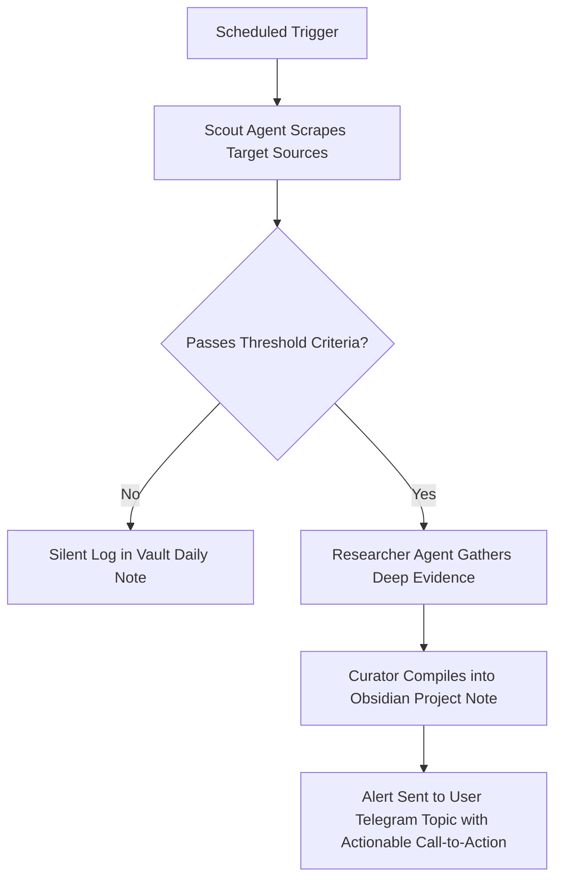
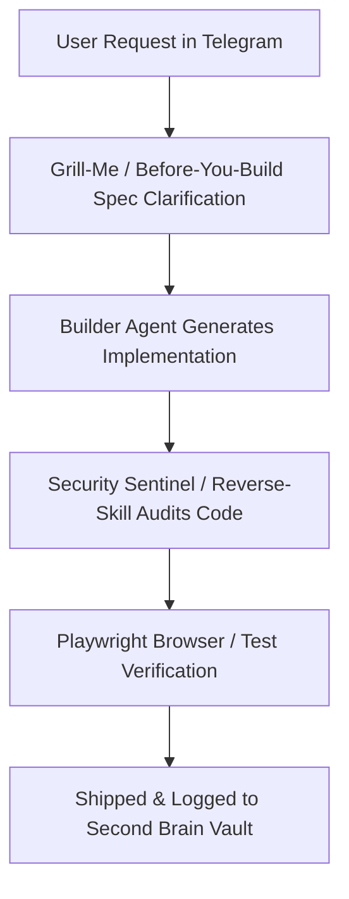

# 🏆 Hermes Ultimate Gold Mine Operating System

This skill upgrades **Hermes Agent** from simple isolated scripts into an autonomous, multi-persona, full-stack intelligence and automation hub.

---

## 🏗️ The 7 Pillars of the Gold Mine Architecture

1. **A Crew Instead of One Agent (Telegram Topic Routing)**:
   - Rather than routing all prompts through a single confused context, instantiate specialized agent personas, each connected to its dedicated Telegram forum topic:
     - 🔭 **Scout Agent**: Opportunity finder, market signals, job alerts, arbitrage, tech radar.
     - 🔬 **Researcher Agent**: Deep web analysis, paper breakdown, competitor benchmarking, YouTube video transcript synthesis.
     - 💻 **Builder Agent**: Architecture, software engineering, bug fixing, test writing, refactoring.
     - 🛡️ **Security Sentinel**: Vulnerability scanning, reverse engineering, dependency auditing, credential leak detection.
     - 📣 **Marketer Agent**: Copywriting, positioning, landing page critique, launch playbooks, social distribution.
     - 🧠 **Second Brain Curator**: Vault management, Obsidian sync, bi-directional linking, memory distillation.

2. **Adaptive Model & Effort Level Allocation**:
   - High-throughput / fast screening: Lightweight model (low latency, minimal tokens).
   - Complex reasoning, architecture, reverse engineering, security: Frontier reasoning models with deep thought budgets.
   - Cost optimization: Cache repeated lookups, leverage local tools first.

3. **Compaction-Proof Obsidian Second Brain Memory**:
   - Integrates directly with `hermes-second-brain`.
   - All learnings, verified snippets, architectural decisions, and open loops are persisted to Markdown files.
   - When memory compacts or sessions reboot, Hermes reloads state from `01_Daily/` and `03_Projects/` without loss.

4. **Scheduled Background Watchers (Signal-to-Noise Filtering)**:
   - Autonomous recurring cron jobs / watchers that inspect APIs, RSS, repositories, or databases.
   - **Crucial Rule**: Only alert the user on high-confidence, actionable events. Never ping with empty "all clear" noise.

5. **Safe & Unified Tooling with Composio**:
   - Integrates 250+ apps (GitHub, Linear, Slack, Gmail, Notion, Twitter, Discord, Telegram, Google Sheets) through Composio MCP / API.
   - Manages OAuth tokens securely without hardcoding secrets in plain text.

6. **Defuddle + Caveman + Humanizer Stack**:
   - **Defuddle**: Web intake stripped to pure semantic markdown.
   - **Caveman Mode**: Extreme token efficiency during repetitive reasoning or bulk data crunching.
   - **Humanizer**: Strips AI-generated buzzwords ("delve", "pivotal", "tapestry") to ensure communication sounds thoughtful, direct, and human.

7. **Spec Alignment & Adversarial Verification (Before-You-Build + Grill-Me)**:
   - Never write code before clarifying requirements.
   - Run interactive interview loops (`grill-me`) to resolve trade-offs upfront.
   - Subject UX and user flows to adversarial edge-case stress testing before shipping.

---

## 🚀 Hermes Gold Mine Workflows

### 1. The Autonomous Scouting Loop

### 2. The Builder & Security Pipeline

---

## 📋 Quick Commands & Triggers

- **Start Scouting Mission**:
  > *"Hermes Goldmine: Launch Scout Agent to monitor trending AI tools in healthcare, filter for open-source GitHub stars > 500, and alert in Telegram #scout."*

- **Compile Intelligence into Second Brain**:
  > *"Hermes Goldmine: Defuddle this YouTube video and research link, extract the top 5 architectural patterns, and save to Obsidian vault under `02_Concepts/`."*

- **Security & Vulnerability Audit**:
  > *"Hermes Goldmine: Run Security Sentinel on this repository using `reverse-skill` and report findings in `05_Playbooks/`."*
