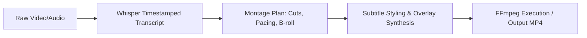

# 🎬 OpenMontage: Automated AI Video Assembly

OpenMontage orchestrates video editing pipelines, transforming raw video assets, screen recordings, voiceovers, and scripts into polished video presentations and social clips.

---

## 🎯 Core Capabilities
1. **Intelligent Clip Trimming & Pacing**: Detects speech cadence and removes silent gaps.
2. **Dynamic Subtitle Synchronization**: Generates styled word-by-word captions (Karaoke / highlight effects).
3. **B-Roll & Overlay Sequencing**: Automatically inserts relevant screenshots, diagrams, and b-roll clips based on spoken keywords.
4. **FFmpeg Script Generation**: Generates hardware-accelerated FFmpeg commands for seamless local rendering.

---

## 🛠️ Typical Pipeline

