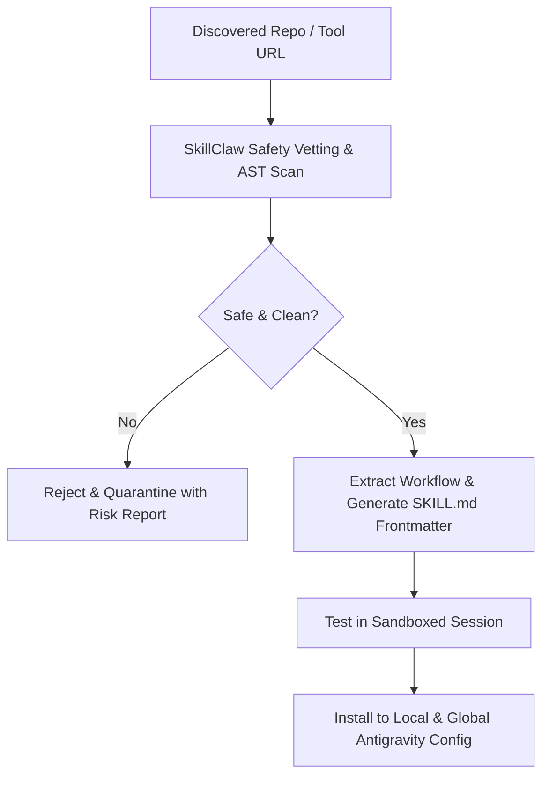

# 🦅 SkillClaw: Automated Skill Discovery & Adaptation

SkillClaw automates the discovery, extraction, safety vetting, and installation of external AI agent skills and MCP servers.

---

## 🎯 The Ingestion Pipeline

---

## 🔒 Safety Verification Gates
- Checks for credential leaks, malicious eval statements, and unauthorized telemetry.
- Ensures all instructions adhere to RFC 2119 standards (`MUST`, `SHOULD`, `MAY`).
- Enforces explicit user confirmation before any tool installs binary dependencies.
